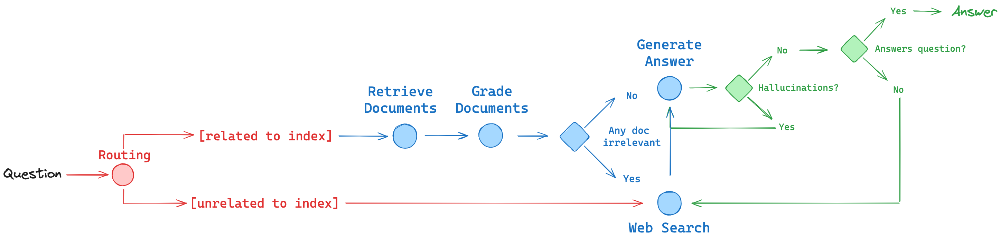

# Agentic RAG architecture

This package answers questions with a LangGraph workflow. A router chooses the local document index or web search. Retrieved documents are graded before an Ollama model drafts an answer; two further graders check whether the answer is supported by the documents and addresses the question.

## Workflow

1. `route_question` sends questions about agents, prompt engineering, or adversarial attacks to `retrieve`; other questions go to `web_search`.
2. `retrieve` searches Chroma. `grade_documents` keeps relevant chunks and requests web search when a chunk is judged irrelevant.
3. `web_search` adds Tavily results when selected by the router or a later decision.
4. `generate` uses the collected document text to draft an answer.
5. The graph checks grounding and whether the answer addresses the question. A useful answer ends the workflow; an unsupported answer is generated again, and an answer that misses the question goes to web search.

## Modules

| Module | Responsibility |
| --- | --- |
| `main.py` | Runs the compiled graph and prints the question, answer, and available source URLs. |
| `ingestion.py` | Loads and splits the source articles, configures Ollama embeddings, and exposes the Chroma retriever. The current index creation block is commented out, so retrieval uses an existing collection in `src/agentic_rag/.chroma`. |
| `graph/graph.py` | Defines the LangGraph nodes, edges, routing decisions, and answer checks; exports the compiled `app`. |
| `graph/state.py` | Defines the shared `GraphState` fields passed between nodes: question, documents, web search flag, and generation. |
| `graph/consts.py` | Names the graph nodes used by the edges and router. |
| `graph/nodes/retrieve.py` | Queries the Chroma retriever and stores matching documents in graph state. |
| `graph/nodes/grade_documents.py` | Filters retrieved documents with the relevance grader and sets the web search flag. |
| `graph/nodes/web_search.py` | Searches Tavily and adds the returned content as a document. |
| `graph/nodes/generate.py` | Formats document text as context, calls the generation chain, and stores the answer. |
| `graph/nodes/__init__.py` | Exposes node functions for graph assembly. |
| `graph/chains/router.py` | Uses an Ollama model to choose the vector store or web search. |
| `graph/chains/retrieval_grader.py` | Judges whether one retrieved chunk is relevant to the question. |
| `graph/chains/generation.py` | Defines the answer prompt and Ollama generation chain. |
| `graph/chains/hallucination_grader.py` | Judges whether the generated answer is supported by the supplied document text. |
| `graph/chains/answer_grader.py` | Judges whether the generated answer addresses the question. |
| `graph/chains/test/test_chains.py` | Contains chain-level checks and example invocations. |

The graph image is stored at `static/graph.png`. Runtime calls use the local Ollama models `qwen3:1.7b` and `embeddinggemma:latest`; web search also needs a Tavily API key.
